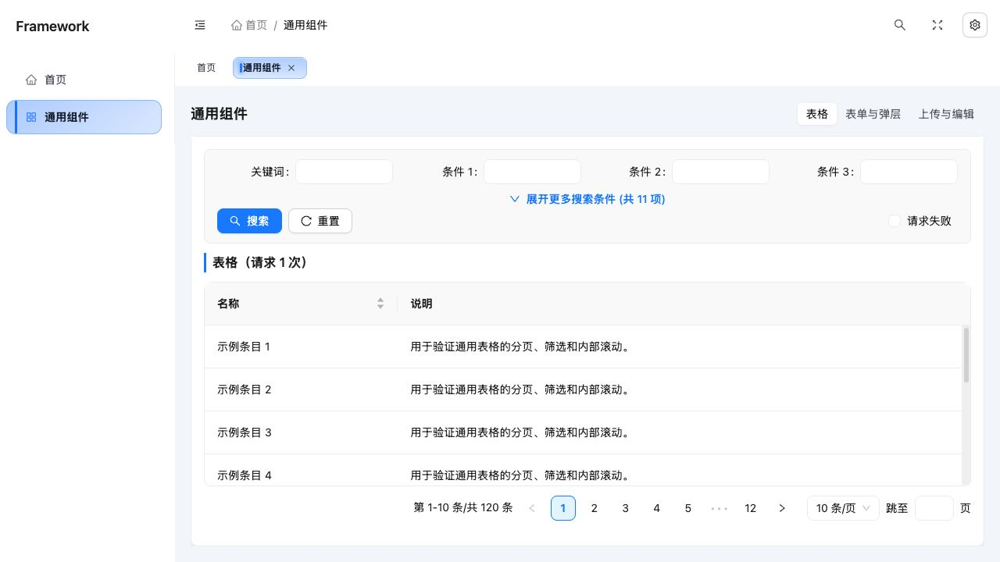
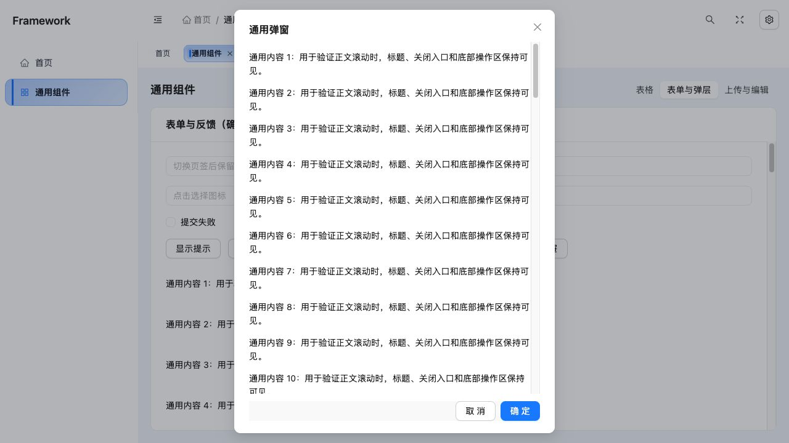

# React Admin Framework

通用管理后台起始框架，基于 React 18、Umi 4、Dva 和 Ant Design 5。它保留后台开发常用的布局、路由、权限边界、状态管理、请求和组件封装，可作为不同业务系统的基础工程。

默认首页与组件验证页完全本地运行，无需账号或后端。仓库不包含业务菜单、业务服务、固定生产地址、自动登录、业务图片或发布凭证。

## 运行截图

2026-11-03 采集，来自源码版本 `9e5c7af` 的本地生产构建，浏览器视口为 1280 × 720。展示页使用本地通用示例数据，无需账号或后端。

**后台布局、条件搜索与表格分页**



**通用弹窗：固定标题和底部操作，长正文独立滚动**



## 快速开始

环境：Node.js 22、npm。依赖以 `package-lock.json` 为准。

```sh
git clone https://github.com/wn228664/react-admin-framework.git
cd react-admin-framework
npm ci
npm run dev
```

开发地址以 Umi 终端输出为准。首次安装会通过 postinstall 执行 `umi setup`，生成 Umi 所需文件。默认访问 `/` 后进入 `/dashboard`；`/components` 可检查表格、搜索、上传、弹窗等通用能力。

```sh
npm run lint          # ESLint，禁止 warning
npm test              # Jest 回归
npm run build         # 生产构建，输出 dist/
npm run verify        # lint → test → build
npm run build:staging # 使用 staging 配置构建
```

## 能力清单

| 层级 | 已包含能力 |
| --- | --- |
| 应用入口 | Antd 上下文、主题、语言、错误边界、消息/弹窗上下文、路由进度 |
| 导航与布局 | 响应式侧栏、菜单搜索、面包屑、全屏、布局设置、访问标签、固定标签、关闭/刷新、页面实例缓存 |
| 状态与访问 | Dva model、菜单配置、角色/权限数据注入、Authorized 展示控制 |
| 网络 | Axios 实例、30 秒默认超时、Bearer 注入、HTTP 错误拒绝、当前凭证的 401 清理、signal 取消 |
| 列表与查询 | ProTable 分页/排序/自动高度/重试，SearchForm 校验、防重、响应式高级搜索 |
| 表单与弹层 | PageContainer、ScrollPanel、AdminModal、AdminDrawer，固定标题/底部与正文内部滚动 |
| 文件与内容 | UploadFile 类型/数量/大小校验、图片压缩、进度、回填、预览、移除/取消；RichTextEditor 图片回调 |
| 其它共享组件 | 图标选择、加载、页面过渡、错误边界、标签和菜单工具 |

## 目录与依赖方向

```text
.
├── .umirc.js                 # Umi、Dva、构建、代理配置
├── .env.example              # 非敏感环境参数示例
├── src/
│   ├── app.jsx               # 根初始化与运行时配置
│   ├── config/routes.js      # 路由、菜单、缓存标记
│   ├── layouts/BasicLayout/  # 后台布局与视口高度链
│   ├── models/               # 布局、设置、菜单、用户权限、标签状态
│   ├── components/           # 可复用组件与相邻测试
│   ├── pages/                # 首页、组件验证、404
│   ├── styles/               # JS / Less token 和全局样式
│   └── utils/                # 请求、凭证、权限、导航和反馈
├── docs/COMMON_COMPONENTS.md # 组件契约与滚动规范
└── package-lock.json         # 可恢复的依赖版本
```

页面组合组件，状态通过 model 管理，业务服务由使用框架的新项目自行接入。通用组件不导入具体业务 service；请求层返回原始响应体，不内置任何业务成功码。

## 环境配置与服务接入

```sh
cp .env.example .env.local
```

| 变量 | 默认值 | 含义 |
| --- | --- | --- |
| `API_BASE_URL` | `/api` | 请求基地址，构建时注入前端 |
| `DEV_PROXY_TARGET` | 未设置 | 设置后开发服务器代理 `/api`，并移除其前缀；不配置时不启用代理 |

修改环境后重新启动开发服务；部署产物需要重新构建。前端配置会进入浏览器代码，服务密钥应由服务端保管。

新增服务时在新项目中组织独立服务模块，调用 `src/utils/request.js`，自行解释服务端响应、校验业务成功与映射错误。失败应 reject，不要将失败转为空列表或伪造成功。新页面可通过 Axios `signal` 取消请求；当前封装的旧 401 防护不等于所有异步任务均已取消。

框架默认没有登录页或完整认证流程。可通过 `user/setAccess` 注入角色和权限，使用 `Authorized` 控制展示；受保护路由与后端鉴权仍需按实际应用实现。认证请求只应通过受信任的 API 实例发往受控服务，业务组件不要把 token 拼入任意外链。

## ahooks 的使用

当前锁定 ahooks 3.9.7：ProTable 使用 useAntdTable，搜索容器使用 useSize，全局搜索、全屏与短视口监听使用 useEventListener。更多适用 API、取消语义、KeepAlive 和状态边界见 [ahooks 接入与使用指南](docs/AHOOKS.md)。

## 页面和组件怎么使用

新增页面后，在 `src/config/routes.js` 的 `menuRoutes` 注册路由，设置 `meta.title`；`meta.affix` 固定标签，`meta.noCache` 关闭该页缓存。动态替换菜单可使用 `menu/setRoutes`。

```jsx
import PageContainer from '@/components/PageContainer';
import ProTable from '@/components/ProTable';

// loadItems({ current, pageSize, ...searchValues }) 返回 { list, total }。
// columns、searchFields 和 loadItems 由新页面定义。
<PageContainer title="列表">
  <ProTable
    rowKey="id"
    columns={columns}
    searchFields={searchFields}
    request={loadItems}
  />
</PageContainer>
```

| 封装 | 接入要点 |
| --- | --- |
| ProTable / SearchForm | request 返回列表与总数；稳定 rowKey；表格 actionRef 提供 reload/submit/reset/getFieldsValue；字段校验和搜索防重由封装负责 |
| AdminModal / AdminDrawer | 受控 open；onOk 可返回 Promise，接收 `{ signal }`；失败保留内容，成功后由调用方关闭；await 后写外部状态前检查 signal |
| UploadFile | 必须显式提供 uploadUrl 或 customRequest；通过 dataPath/dataTransform 解析 URL，通过 validateResponse 校验业务成功；移除/清空/卸载忽略迟到结果 |
| RichTextEditor | 通过 `uploadImage(file): Promise<string>` 接入图片服务，不包含默认上传地址 |
| ScrollPanel | 长表单、上传列表、编辑器的组件内滚动容器 |

完整参数、返回值、取消和错误契约见 [通用封装使用规范](docs/COMMON_COMPONENTS.md)。

## 后台滚动规范

**后台内容只能在组件内部滚动，页面和应用外壳不滚动。**

- 根页面使用 PageContainer 分配剩余高度；可伸缩区域设置 `min-height: 0`。
- 长表单、上传和编辑器放进 ScrollPanel；列表使用 ProTable。
- 弹层使用 AdminModal / AdminDrawer，标题和 footer 保留，只有正文 body 滚动。
- 表格根据所在容器测量高度，不依赖 window 高度；可嵌入有限高度的弹层。
- 不在页面根增加 `overflow: auto`、`min-height: 100vh` 或用视口高度硬算表格尺寸。
- 菜单、标签和极短视口下的搜索区域各自滚动；不要用外层隐藏溢出掩盖不可访问内容。

## 作为新项目使用

1. 克隆或使用本仓库创建独立工程，修改 package 名称、标题、favicon 和主题 token。
2. 保留布局、组件、model 边界，按需替换首页与组件验证页。
3. 根据真实接口添加服务模块、认证和权限数据，配置自己的环境与部署地址。
4. 注册新路由，沿用组件滚动规范；关键表单与写操作接入 loading、防重、取消及错误反馈。
5. 执行 `npm run verify`，再对实际新增页面验证窄屏、长内容、弹层和服务请求。

## 构建与部署

`npm run build` 输出 `dist/`。本仓库不包含托管服务或自动部署流程；将产物部署到静态服务器，并配置 history 回退。部署到根路径时可使用以下 Nginx location：

```nginx
location / {
    try_files $uri $uri/ /index.html;
}
```

API 转发、HTTPS、访问控制由部署环境配置。部署在子路径时需同步配置 Umi 的路由与资源前缀，不直接照搬根路径示例。

## 验证记录与常见问题

2026-11-02 的框架验收：ESLint 零警告，15 个测试套件 / 73 项测试通过，生产构建成功；浏览器检查过桌面、平板、窄屏、横屏及表格/搜索/弹层滚动边界。这是通用框架验证，接入真实后端后仍需验证新接口与权限。

- **上传按钮不可用**：检查是否配置 uploadUrl 或 customRequest；框架不会猜测上传接口。
- **刷新子路由出现 404**：静态服务器缺少 history 回退。
- **组件被裁切或页面出现滚动条**：先检查 PageContainer、组件父容器高度链和 `min-height: 0`，不要给页面根开启滚动补救。
- **后台接口看似成功但列表为空**：在服务适配层检查真实业务信封与 list/total 映射，不在组件中硬编码成功码。

仓库包含源码、测试、说明和锁文件；node_modules、dist、本机配置、日志和凭证不进入版本控制。
